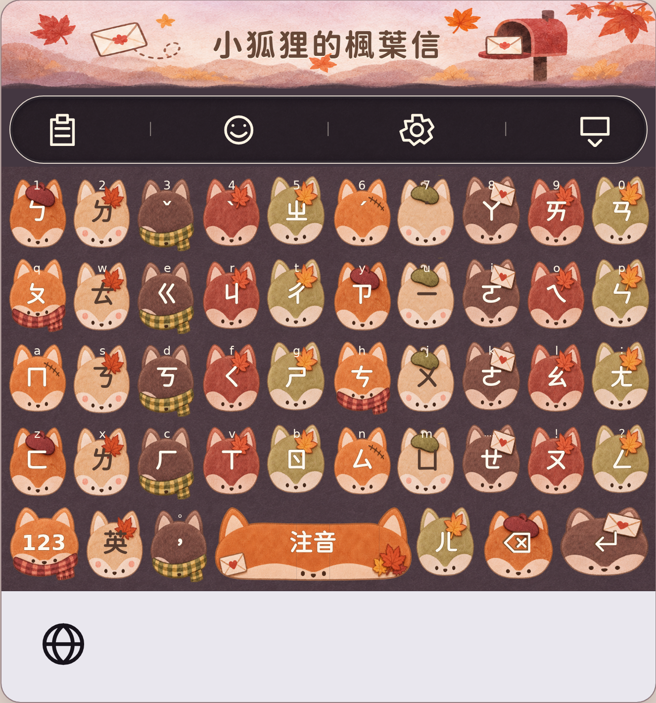

# 小狐狸的楓葉信：主題與版面預覽

先開啟 [完整主題預覽](theme.html)，不需要安裝套件或啟動伺服器。可切換六種現有輸入模式、123／符號／數字盤及面板示意，並調整高度、字體、間距、造型大小、透明度與寬度。日文沿用現有羅馬字配置，沒有新增十二鍵假名輸入法。



另有 [英文鍵盤水彩修正版](theme-keyboard-english-v2.png)、[英文截圖](theme-english.png)、[手寫截圖](theme-handwriting.png) 及 [階段 A 單顆版型](index.html)。本輪已改為水彩素材。iPhone 程式新增 52 pt 山景標題區（橫向 34 pt），保留原按鍵區高度；Xcode 實際顯示尚待驗證。

## iPhone 套用方式

開啟糯糯鍵盤的 **設定 → 主題 → 小狐狸的楓葉信** 角色卡片。

- 九款水彩鍵帽、獨立寬版空白鍵／換行鍵、秋日山景與紙感背景，取代原先平面向量外觀。
- 原本的造型、質感與照片繼續保存。主題期間使用配色背景，切回一般主題後恢復照片。
- 個人字體、高度、間距、動畫與空白鍵圖片／GIF仍可使用。自選空白鍵圖片會取代信封配件。
- 矮功能鍵簡化五官與配件，優先保留功能文字大小。
- 按鍵表面透明度與文字分開，字色會依毛色及透明度調整。
- 奶油色在部分中間透明度下會加相反明暗的細字邊；按壓後仍使用對應字色與細邊。
- 系統外側容器、地球／麥克風區域仍由 iOS 管理。

## 這次確認什麼

- 狐狸臉形輪廓，中央白色文字，下緣小五官；沒有另外畫身體。
- 英文窄鍵 34 × 48 pt、注音鍵 36 × 46 pt、寬鍵 160 × 46 pt。
- 寬鍵只延展輪廓中段，耳朵與五官不跟著水平拉長。
- 顯示放大與原尺寸版本，以及一排連續窄鍵，供判斷可讀性。

**平面向量外觀已由使用者退回。此水彩修正版尚待視覺確認，自動檢查不代表美術定稿。**

目前已接入共用 `KeyButton`／`KeyboardGridView`，手寫側欄也使用這套繪製；候選字、功能鍵和各面板沿用原本功能與主題色。

## 原始資料與重建

`tools/fox_letter_prototype.json` 保留幾何與配色資料；`tools/fox_letter_watercolor.js` 管理水彩圖集取樣。三張 PNG 存在 `Keyboard/Resources/FoxLetter/`，由內建 image_gen 製作，提示詞見 [ART_PROMPTS.md](ART_PROMPTS.md)。文字不烘焙在圖片中。

```sh
node tools/build_fox_letter_prototype.js
node tools/build_fox_letter_theme.js
```

會產生：

- `Keyboard/FoxLetterPrototype.swift`：UIKit 的 `CAShapeLayer` 原型，沿用 `KeyShapeArt.build` 的路徑繪製方式。
- `docs/previews/fox-letter/index.html`：離線 SVG 預覽。
- `Keyboard/FoxLetterArtwork.swift`：主題配色與配件圖層。
- `docs/previews/fox-letter/theme.html`：完整主題及版面示意。

`Keyboard/FoxLetterTheme.swift` 管理角色繪製、寬鍵、矮功能鍵、字色與有效外觀設定。瀏覽器版面只供視覺檢查；注音／符號字元取自專案資料，真正配置與動作仍由 `Keyboard/KeyLayouts.swift` 決定。

請修改原始 JSON 或產生器，再重新產生；不要直接修改產生出的 Swift 或 HTML。`preview.png` 是瀏覽器截圖，修改版型後需另行更新。

## 驗證

```sh
node tools/tests/fox_letter_prototype.test.js
node tools/tests/fox_letter_theme.test.js
node tools/tests/fox_letter_watercolor.test.js
node tools/build_fox_letter_prototype.js --check
node tools/build_fox_letter_theme.js --check
git diff --check
```

14 項 Node 測試涵蓋文字分區、五官比例、寬鍵尺寸、有效路徑、產生檔一致性、192 組預覽配置、欄數／Shift／符號與透明度字色。

完整預覽另以 Chromium 通過 384 個模式／頁面／尺寸場景、12,016 個實際字形邊界、924 次按壓外觀檢查，並檢查欄數切換、韓文 Shift、日文羅馬字、地球鍵、全半形、候選列／面板示意與點按回饋。兩個預覽頁在 320／390／430 px 下沒有整頁水平溢出，未出現 JavaScript 例外。

可用 `node tools/check_fox_letter_browser.js --output docs/previews/fox-letter` 重跑，需 Node 22+、Chromium 及 CJK／注音字體。詳細結果、環境需求與本輪修正見 [Linux 本機驗收記錄](ACCEPTANCE.md)；機器輸出為 [acceptance.json](acceptance.json)。另有 [極端窄版](theme-compact.png) 與 [40% 透明度字邊](theme-contrast.png) 截圖。極端縮小設定下文字仍會明顯變小，閱讀舒適度尚未定稿。

## 原生測試與待驗證項目

`KeyboardTests/FoxLetterThemeTests.swift` 的 13 項測試使用真正的 UIKit、`KeyLayouts`、`KeyButton`，涵蓋所有現有模式與頁面、注音欄數、地球鍵、窄／橫向尺寸、手寫側欄、角色重用、大小寫、主題切換與個人外觀保留；另檢查連打後的圖層／路徑穩定性、共享快取、配件切換與視圖釋放，量測按壓更新時間和記憶體。

已新增 `StarKeyboardThemeTests` scheme 與 CI 執行步驟，保存測試日誌與 `.xcresult`。在 Mac 產生 Xcode 專案後，可選該 scheme 與 iPhone 模擬器執行測試。完整步驟及真機驗收記錄見 [原生驗證說明](../../../KeyboardTests/README.md)。

繪製優化：按壓取用預先準備的字面、字色與功能圖示，更新透明度與動畫；圖集以最長邊 768 px 載入並共用 CGImage，每鍵最多五個切片圖層；角色切換只更新取樣區。向量路徑保留作 fallback。

**目前 Linux 環境沒有 Xcode，尚未執行 iOS 編譯或 UIKit 測試。** 實際輸入、長按、滑行、游標拖曳、各字體、個人圖片／GIF、真機外觀、連續輸入效能及記憶體仍需安裝後檢查。瀏覽器檢查不取代這些驗證。
